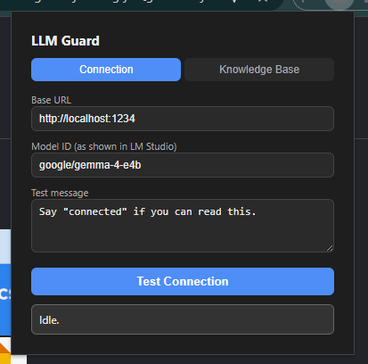
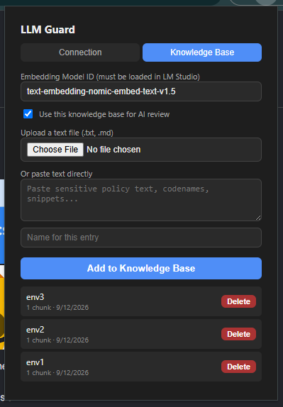
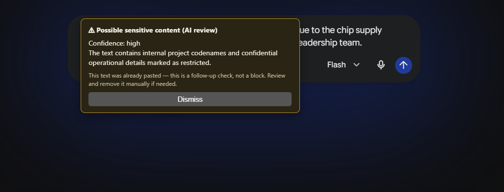
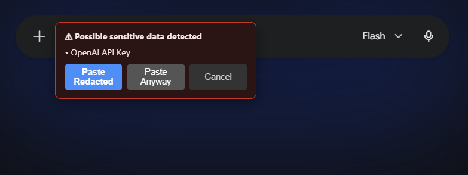
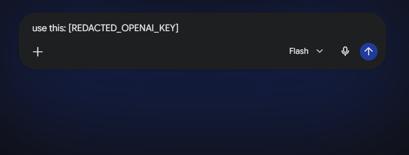
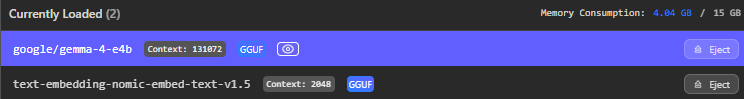

# LLM Guard

A browser extension that detects and prevents sensitive data leakage when pasting text into websites, including public LLM chat interfaces, email clients, and any other web page. It runs entirely on local infrastructure: no data is ever sent to a third party cloud service for analysis.

The extension uses a two tier hybrid detection pipeline. A fast, deterministic regex engine catches structured secrets like API keys instantly with no network call. A slower, semantic layer backed by a locally hosted LLM and a user built knowledge base catches unstructured leaks such as internal project codenames, proprietary details, or confidential language that regex cannot recognize.

## Why this exists

Employees regularly paste sensitive information into public tools without realizing it: AWS credentials into a ChatGPT prompt, a customer's database connection string into an email, an internal project codename into a public forum. Enterprise Data Loss Prevention (DLP) software exists to catch this, but it is expensive, cloud dependent, and often opaque about what it is scanning. LLM Guard is a self hosted, transparent alternative that runs entirely on the user's own machine and their own local LLM, with full control over what gets flagged and why.

## Architecture overview

```
User pastes text into any webpage
            |
            v
   content.js intercepts the paste event
            |
            v
   Tier 1: Regex Engine (detectors.js)
   - Runs synchronously, in milliseconds
   - Checks against ~16 known secret patterns
            |
      Match found? ---- YES ----> Block paste, show warning banner
            |                     Options: Paste Redacted / Paste Anyway / Cancel
            NO
            |
            v
   Tier 2: Semantic Analysis (llm-analyzer.js)
   - Only runs if Tier 1 found nothing and Tier 2 is enabled
   - Does NOT block the paste (avoids freezing the browser on a network call)
   - Paste proceeds immediately
            |
            v
   RAG Retrieval (rag-store.js), if a knowledge base exists
   - Embeds the pasted text
   - Finds the most similar chunks from user uploaded documents
   - Passes them as context to the LLM
            |
            v
   Local LLM call to LM Studio (google/gemma-4-e4b or similar)
   - Asked to return a strict JSON verdict: leak true/false, confidence, reason
            |
      Verdict is a leak? ---- YES ----> Show a retroactive "AI review" warning banner
            |
            NO
            |
       Stay silent (no alert, no interruption)
```

The core design principle is: if nothing is wrong, the extension says nothing. No confirmation popups, no "this looks fine" messages. It only speaks up when it finds something.

## Technical stack

| Component | Technology |
|---|---|
| Extension platform | Chrome Extension, Manifest V3 |
| Regex engine | Vanilla JavaScript, no dependencies |
| Local LLM server | LM Studio (OpenAI compatible REST API) |
| Chat / classification model | google/gemma-4-e4b (a reasoning capable model) |
| Embedding model | text-embedding-nomic-embed-text-v1.5 |
| Vector storage | chrome.storage.local (with the unlimitedStorage permission) |
| Similarity search | Cosine similarity, computed in plain JavaScript, no external vector database |
| UI | Plain HTML, CSS, and JavaScript (popup and options pages) |

No npm packages, build steps, or bundlers are required. Every file is loaded directly by the browser.

## Features

### Tier 1: Deterministic regex detection

Runs instantly on every paste, with no network dependency. It recognizes:

- AWS Access Key IDs
- AWS Secret Access Keys (heuristic, gated by nearby context such as the word "aws" or "secret" to reduce false positives)
- OpenAI API keys (`sk-...`, `sk-proj-...`)
- Anthropic API keys (`sk-ant-...`)
- GitHub Personal Access Tokens (classic and fine grained)
- Slack tokens
- Google API keys
- Stripe API keys (live and test)
- Private key blocks (RSA, EC, OpenSSH, DSA, PGP)
- JWT tokens
- Bearer tokens in header format
- Database connection strings (Postgres, MySQL, MongoDB)
- Credit card numbers, validated with a Luhn checksum to reduce false positives on ordinary long numbers
- Generic `KEY=value` or `KEY: value` patterns where the key name suggests a secret (for example `API_KEY`, `PASSWORD`, `ACCESS_TOKEN`)

When a Tier 1 match is found, the native paste is blocked before it reaches the page. A warning banner appears next to the field showing which types of secrets were detected, with three options:

- **Paste Redacted**: automatically replaces every detected secret with a placeholder such as `[REDACTED_AWS_ACCESS_KEY]` and pastes the cleaned text
- **Paste Anyway**: pastes the original, unmodified text, for cases where the user consciously decides the content is safe to share
- **Cancel**: discards the paste entirely

Overlapping matches (for example, a string that matches both a specific pattern like an Anthropic key and the generic `KEY=value` pattern) are merged into a single redaction span so the resulting text stays valid and readable, rather than producing broken or duplicated placeholders.

### Tier 2: Semantic analysis via local LLM

For text that passes the regex check but may still be sensitive in a way that pattern matching cannot catch (business context, project names, internal jargon), the extension sends the pasted text to a locally running LLM for a judgment call.

Because a local LLM call can take several seconds, especially with a reasoning capable model, Tier 2 is designed to never block the paste. The text is pasted immediately, and if the LLM later flags it as sensitive, a follow up warning banner appears asking the user to review and manually remove the content if needed. This keeps the browsing experience responsive at the cost of the warning arriving slightly after the fact rather than before.

The LLM is prompted with a strict system instruction to return only a JSON object:

```json
{"leak": true, "confidence": "high", "reason": "Contains an internal project codename and deployment timeline"}
```

The response parser is defensive against common local model quirks: markdown code fences around the JSON, extra prose before or after the JSON, and reasoning model behavior where the model writes an internal thought process before (or instead of) the final answer. If a genuinely valid verdict cannot be found in the response, the extension fails safe and treats it as no leak, rather than risking a false alarm from garbled output.

Tier 2 is entirely optional and is only active if explicitly enabled in the extension's settings, since it requires a local LLM server to be running.

### RAG powered knowledge base

The extension includes a full Retrieval Augmented Generation (RAG) pipeline so that Tier 2 analysis can be grounded in the user's own definition of what counts as sensitive, rather than relying purely on the LLM's general judgment.

How it works:

1. The user uploads a text file (`.txt` or `.md`) or pastes text directly into the Knowledge Base tab of the extension popup. This can be internal policy documents, lists of project codenames, example sensitive data, or anything else that defines what should be protected.
2. The text is split into overlapping chunks (800 characters per chunk, 100 character overlap, to avoid losing context at chunk boundaries).
3. Each chunk is sent to LM Studio's embeddings endpoint using the loaded embedding model, producing a vector representation.
4. Chunks and their vectors are stored persistently in `chrome.storage.local`, keyed by a unique document ID.
5. When new text is pasted and Tier 2 runs, the pasted text is embedded the same way, and cosine similarity is computed against every stored chunk.
6. The most relevant chunks (up to three, above a minimum similarity threshold) are retrieved and injected into the LLM's prompt as reference material, before asking whether the pasted text represents a leak.

This means the same pasted text can be judged differently depending on what the user has taught the system. A generic phrase like "the new deployment" might be ignored, but if the knowledge base contains a document that defines "Project Falcon" as an internal codename, a paste mentioning Project Falcon and a deployment timeline will be flagged with high confidence and a specific reason.

### Knowledge base management UI

The extension popup has a dedicated Knowledge Base tab where the user can:

- Set the embedding model ID (must match a model already loaded in LM Studio)
- Toggle whether the knowledge base is used at all during Tier 2 review
- Upload a `.txt` or `.md` file directly from disk
- Paste text manually with a custom name for the entry
- View every indexed document with its chunk count and the date it was added
- Delete any individual document, which removes both its metadata and all of its stored embeddings

All of this is local. Nothing uploaded to the knowledge base leaves the machine; it is embedded via the local LM Studio server and stored in the browser's own local storage.

### Persistent storage

All extension state, including the knowledge base, connection settings, and feature toggles, is stored using `chrome.storage.local` with the `unlimitedStorage` permission enabled, so document and embedding storage is not capped by the default browser storage quota. Data persists across browser restarts and extension reloads, and is never synced externally.

## Settings reference

Configured through the extension's popup and options pages.

| Setting | Description | Default |
|---|---|---|
| Base URL | The address of the local LM Studio server | `http://localhost:1234` |
| Model ID | The chat/completion model used for Tier 2 analysis | `google/gemma-4-e4b` |
| Enable AI (Tier 2) analysis | Master toggle for semantic analysis | Off |
| Embedding Model ID | The embedding model used for the knowledge base | (user supplied, e.g. `text-embedding-nomic-embed-text-v1.5`) |
| Use this knowledge base for AI review | Toggle for whether RAG context is included in Tier 2 prompts | Off |

## File structure

```
llm-guard-ext/
├── manifest.json          Extension configuration (Manifest V3)
├── content.js              Injected into every page; intercepts paste events, orchestrates Tier 1 and Tier 2
├── detectors.js             Tier 1 regex engine and redaction logic
├── llm-analyzer.js          Tier 2 LLM call, prompt construction, response parsing
├── rag-store.js              Document chunking, embedding, storage, and retrieval
├── popup.html / popup.js      Extension popup UI: connection test and knowledge base management
├── options.html / options.js  Extension settings page
└── test-page.html            Standalone HTML page with a textarea, input, and contenteditable div for manual testing
```

## How the paste flow actually works, in detail

1. A `paste` event listener is attached to the document in the capture phase, so it runs before any site specific paste handler (important for sites like Gmail that implement their own rich text editing behavior).
2. When a paste occurs in an editable field (a `<textarea>`, an `<input>`, or a `contenteditable` element), the pasted plain text is extracted from the clipboard event.
3. Tier 1 regex scanning runs synchronously on that text.
4. If Tier 1 finds a match, the current text selection (cursor position or highlighted range) is captured before anything else happens. This is necessary because the selection can change once buttons in the warning banner are clicked, and without saving it first, the replacement text would be inserted in the wrong place, sometimes resulting in duplicated text.
5. The native paste is cancelled with `preventDefault()`, `stopPropagation()`, and `stopImmediatePropagation()`, and a warning banner is rendered as an absolutely positioned element near the target field.
6. If the user chooses to proceed (redacted or as is), the extension manually inserts the text at the saved selection point, using the appropriate method for the field type: direct `value` manipulation for `<textarea>`/`<input>`, or `document.execCommand('insertText')` with the selection explicitly restored for `contenteditable` elements.
7. If Tier 1 finds nothing and Tier 2 is enabled, the paste is allowed to proceed immediately and unmodified. In the background, the extension optionally retrieves relevant chunks from the knowledge base, then sends the pasted text (plus any retrieved context) to the local LLM. If the LLM's verdict indicates a leak, a second style of banner appears, framed explicitly as a retroactive, informational warning rather than a blocking action.

## Known limitations

- Tier 2 cannot block the paste, only warn after the fact, because blocking on a network call to a local LLM would introduce noticeable input lag on every paste across every website.
- Reasoning capable models (such as Gemma's thinking variants) can spend a significant number of tokens on internal reasoning before producing a final answer. The token budget and timeout for Tier 2 requests are set generously to accommodate this, but response times of five to fifteen seconds or more are possible depending on hardware.
- The AWS Secret Access Key heuristic and the generic `KEY=value` pattern are intentionally broad and can occasionally produce false positives, since there is no universal format for these secrets. They are gated by nearby context keywords to reduce noise.
- Content editable insertion uses `document.execCommand`, which is a deprecated browser API. It remains the most broadly compatible method across different sites' rich text editors at the time of writing, since no fully supported modern replacement exists for arbitrary third party contenteditable regions.
- The extension currently requests host permissions for all URLs (`<all_urls>`), since sensitive data can be pasted on any website. This is a broad permission and Chrome will surface a corresponding warning at install time.

## Screenshots

### Connection settings
Configuring the base URL and model ID for the local LM Studio server, with a built in connection test.



### Knowledge base management
Uploading documents, setting the embedding model, and managing indexed entries with delete support.



### Tier 1 block in action
A detected OpenAI API key blocks the paste and presents redact, proceed, or cancel options.



### Result after choosing Paste Redacted
The secret is replaced with a clear placeholder before being inserted into the page.



### Tier 2 semantic warning
A retroactive warning shown after the local LLM flags pasted text as containing an internal project codename and confidential operational details, informed by the user's own knowledge base.



### LM Studio with both models loaded
The chat model and the embedding model running simultaneously in LM Studio, both reachable through the same local server.



## Setup

1. Install and open LM Studio.
2. Load a chat capable model (this project was built and tested against `google/gemma-4-e4b`).
3. Load an embedding model if the knowledge base feature will be used (this project was built and tested against `text-embedding-nomic-embed-text-v1.5`).
4. Start the local server from LM Studio's server tab. Note the port, `1234` by default.
5. In Chrome, go to `chrome://extensions`, enable Developer Mode, and click Load Unpacked, then select this project's folder.
6. Open the extension popup, go to the Connection tab, enter the base URL and model ID, and click Test Connection to confirm connectivity.
7. Optionally, go to the Knowledge Base tab to upload reference documents and enable RAG assisted Tier 2 review.
8. Paste sensitive test data into any webpage to confirm detection is working as expected.
